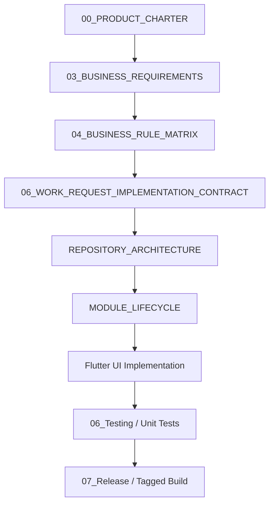

# Grow Platform Master Catalog & Navigation Index

Status: Approved — **canonical navigation index**
Owner: Lead Architect  
Version: 2.0  
Last updated: 2026-08-04  
Depends on: `docs/DOCUMENTATION_GOVERNANCE.md`  

`docs/documentation_index.md` duplicated this file's purpose and is now
marked superseded in favor of this one. This file is the actively maintained
index — update this one when documentation changes; do not revive the other.

---

## 1. Executive Summary

This Master Catalog is the single authoritative entry point for the entire Grow platform documentation suite. It categorizes all root governance policies, product requirements, architecture blueprints, database specifications, security policies, DevOps guides, test matrices, release notes, performance benchmarks, and archival records.

---

## 2. Platform Document Hierarchy

---

## 3. Section Catalog

### 00_Project_Management (Operational Tracking)
- [`MASTER_INDEX.md`](file:///f:/kannan/projects/Grow/grow/docs/00_Project_Management/MASTER_INDEX.md) — Master index catalog
- [`APPROVAL_LOG.md`](file:///f:/kannan/projects/Grow/grow/docs/00_Project_Management/APPROVAL_LOG.md) — Formal phase approval log
- [`FEATURE_INVENTORY.md`](file:///f:/kannan/projects/Grow/grow/docs/00_Project_Management/FEATURE_INVENTORY.md) — Module readiness & status matrix
- [`TECHNICAL_DEBT_REGISTER.md`](file:///f:/kannan/projects/Grow/grow/docs/00_Project_Management/TECHNICAL_DEBT_REGISTER.md) — Technical debt log
- [`API_READINESS_MATRIX.md`](file:///f:/kannan/projects/Grow/grow/docs/00_Project_Management/API_READINESS_MATRIX.md) — Integration layer readiness
- [`PRODUCT_BACKLOG.md`](file:///f:/kannan/projects/Grow/grow/docs/00_Project_Management/PRODUCT_BACKLOG.md) — Product backlog
- [`PROJECT_STATUS.md`](file:///f:/kannan/projects/Grow/grow/docs/00_Project_Management/PROJECT_STATUS.md) — Current status
- [`RISK_REGISTER.md`](file:///f:/kannan/projects/Grow/grow/docs/00_Project_Management/RISK_REGISTER.md) — Risk register & mitigations
- [`ARCHITECTURAL_DECISION_RECORDS/`](file:///f:/kannan/projects/Grow/grow/docs/00_Project_Management/ARCHITECTURAL_DECISION_RECORDS/) — Individual ADR files (ADR-0001..0004; note: a separate, un-reconciled ADR list also exists at root `/ARCHITECTURE_DECISIONS.md`, ADR-001..007 — flagged in the 2026-09-01 repo audit, not merged)
- [`TECHNICAL_BIBLE.md`](file:///f:/kannan/projects/Grow/grow/docs/00_Project_Management/TECHNICAL_BIBLE.md) — Normative cross-cutting engineering contract

### 01_Product (Requirements & Scope)
- [`00_PRODUCT_CHARTER.md`](file:///f:/kannan/projects/Grow/grow/docs/01_Product/00_PRODUCT_CHARTER.md) — Platform mission & charter
- [`01_EXECUTIVE_SUMMARY.md`](file:///f:/kannan/projects/Grow/grow/docs/01_Product/01_EXECUTIVE_SUMMARY.md) — Executive summary
- [`02_PRODUCT_VISION.md`](file:///f:/kannan/projects/Grow/grow/docs/01_Product/02_PRODUCT_VISION.md) — Product vision
- [`03_BUSINESS_REQUIREMENTS.md`](file:///f:/kannan/projects/Grow/grow/docs/01_Product/03_BUSINESS_REQUIREMENTS.md) — Business requirements (BRD)
- [`04_BUSINESS_RULE_MATRIX.md`](file:///f:/kannan/projects/Grow/grow/docs/01_Product/04_BUSINESS_RULE_MATRIX.md) — Consolidated business rule IDs
- [`05_WORK_REQUEST_REQUIREMENTS.md`](file:///f:/kannan/projects/Grow/grow/docs/01_Product/05_WORK_REQUEST_REQUIREMENTS.md) — Work Request SRS
- [`06_WORK_REQUEST_IMPLEMENTATION_CONTRACT.md`](file:///f:/kannan/projects/Grow/grow/docs/01_Product/06_WORK_REQUEST_IMPLEMENTATION_CONTRACT.md) — Implementation contract
- [`07_UX_INTEGRATION_BLUEPRINT.md`](file:///f:/kannan/projects/Grow/grow/docs/01_Product/07_UX_INTEGRATION_BLUEPRINT.md) — Draft UX, navigation, and integration blueprint; does not replace approved module requirements
- [`PRODUCT_SCOPE.md`](file:///f:/kannan/projects/Grow/grow/docs/01_Product/PRODUCT_SCOPE.md) — User outcomes and V1 non-goals
- [`BUSINESS_GLOSSARY.md`](file:///f:/kannan/projects/Grow/grow/docs/01_Product/BUSINESS_GLOSSARY.md) — Business glossary

### 02_Architecture (System & Codebase Structure)
- [`REPOSITORY_ARCHITECTURE.md`](file:///f:/kannan/projects/Grow/grow/docs/02_Architecture/REPOSITORY_ARCHITECTURE.md) — Directory layout & layer rules
- [`MODULE_LIFECYCLE.md`](file:///f:/kannan/projects/Grow/grow/docs/02_Architecture/MODULE_LIFECYCLE.md) — 9-phase module gate standard
- [`MODULE_DEPENDENCY_GRAPH.md`](file:///f:/kannan/projects/Grow/grow/docs/02_Architecture/MODULE_DEPENDENCY_GRAPH.md) — Feature dependency graph & blockages
- [`FEATURE_MODULE_TEMPLATE.md`](file:///f:/kannan/projects/Grow/grow/docs/02_Architecture/FEATURE_MODULE_TEMPLATE.md) — Layout template for new features
- [`system_architecture.md`](file:///f:/kannan/projects/Grow/grow/docs/02_Architecture/system_architecture.md) — System design blueprint
- [`product_architecture.md`](file:///f:/kannan/projects/Grow/grow/docs/02_Architecture/product_architecture.md) — Module boundary map
- [`feature_flags.md`](file:///f:/kannan/projects/Grow/grow/docs/02_Architecture/feature_flags.md) — Feature flags
- [`offline_sync.md`](file:///f:/kannan/projects/Grow/grow/docs/02_Architecture/offline_sync.md) — Offline sync & replay queue
- [`media_upload_state_machine.md`](file:///f:/kannan/projects/Grow/grow/docs/02_Architecture/media_upload_state_machine.md) — Media upload state machine
- [`provider_graph.md`](file:///f:/kannan/projects/Grow/grow/docs/02_Architecture/provider_graph.md) — Riverpod provider dependency map
- [`rc5_design_system.md`](file:///f:/kannan/projects/Grow/grow/docs/02_Architecture/rc5_design_system.md) — Design tokens & theme tokens
- [`storage_architecture.md`](file:///f:/kannan/projects/Grow/grow/docs/02_Architecture/storage_architecture.md) — Storage architecture (moved from stray `docs/storage/` in 2026-09-01 audit — was previously unindexed here)

### 03_Database (Data & API)
- [`database_schema.md`](file:///f:/kannan/projects/Grow/grow/docs/03_Database/database_schema.md) — Database schema reference
- [`api_contracts.md`](file:///f:/kannan/projects/Grow/grow/docs/03_Database/api_contracts.md) — API contracts & DTO specifications

### 04_Security & Governance
- [`DOCUMENTATION_GOVERNANCE.md`](file:///f:/kannan/projects/Grow/grow/docs/DOCUMENTATION_GOVERNANCE.md) — Documentation rules & standards
- [`DOCUMENTATION_DEBT_REPORT.md`](file:///f:/kannan/projects/Grow/grow/docs/DOCUMENTATION_DEBT_REPORT.md) — Documentation debt log
- [`AI_DEVELOPMENT_GUIDE.md`](file:///f:/kannan/projects/Grow/grow/docs/AI_DEVELOPMENT_GUIDE.md) — AI pair programming standards
- [`security_policy.md`](file:///f:/kannan/projects/Grow/grow/docs/04_Security/security_policy.md) — Security policy pointer
- [`TRUST_BOUNDARY.md`](file:///f:/kannan/projects/Grow/grow/docs/04_Security/TRUST_BOUNDARY.md) — Camera/device-sensor trust boundary

### 05_DevOps & Automation
- [`CI_CD.md`](file:///f:/kannan/projects/Grow/grow/docs/05_DevOps/CI_CD.md) — Current PR flow, CI checks, and verified branch-protection status (start here)
- [`ci_pipeline_map.md`](file:///f:/kannan/projects/Grow/grow/docs/05_DevOps/ci_pipeline_map.md) — CI workflow detail & consolidation history
- [`git_strategy.md`](file:///f:/kannan/projects/Grow/grow/docs/05_DevOps/git_strategy.md) — Git strategy pointer (stale branch snapshot, see 2026-09-01 note in the file)
- [`git_policy.md`](file:///f:/kannan/projects/Grow/grow/docs/05_DevOps/git_policy.md) — Branch & PR policy (overlaps git_strategy.md, flagged in audit)
- [`branch_protection.json`](file:///f:/kannan/projects/Grow/grow/docs/05_DevOps/branch_protection.json) — Branch protection spec
- [`pr_body.txt`](file:///f:/kannan/projects/Grow/grow/docs/05_DevOps/pr_body.txt) — PR body template

### 06_Testing & Failure Modes
- [`test_inventory.md`](file:///f:/kannan/projects/Grow/grow/docs/06_Testing/test_inventory.md) — Test suite inventory
- [`failure_scenarios.md`](file:///f:/kannan/projects/Grow/grow/docs/06_Testing/failure_scenarios.md) — Failure mode matrix
- [`profile_migration_test_matrix.md`](file:///f:/kannan/projects/Grow/grow/docs/06_Testing/profile_migration_test_matrix.md) — Profile sync test matrix

### 07_Release & Operations
- [`DELIVERY_GATES.md`](file:///f:/kannan/projects/Grow/grow/docs/07_Release/DELIVERY_GATES.md) — Evidence required per milestone (not per-PR — see DEFINITION_OF_DONE.md for that)
- [`CHANGELOG.md`](file:///f:/kannan/projects/Grow/grow/docs/07_Release/CHANGELOG.md) — Changelog
- [`release_checklist.md`](file:///f:/kannan/projects/Grow/grow/docs/07_Release/release_checklist.md) — Release checklist
- [`release_rollback.md`](file:///f:/kannan/projects/Grow/grow/docs/07_Release/release_rollback.md) — Rollback procedure
- [`performance_baseline.md`](file:///f:/kannan/projects/Grow/grow/docs/07_Release/performance_baseline.md) — Performance baseline
- [`rc44_validation_report.md`](file:///f:/kannan/projects/Grow/grow/docs/07_Release/rc44_validation_report.md) — RC4.4 validation report
- [`BETA_TEST_NOTES.md`](file:///f:/kannan/projects/Grow/grow/docs/07_Release/BETA_TEST_NOTES.md) — Beta feedback
- [`rc5_beta_manifest.md`](file:///f:/kannan/projects/Grow/grow/docs/07_Release/rc5_beta_manifest.md) — RC5 beta manifest

### 08_Migrations & 09_Performance
- [`profile_migration_phase_a.md`](file:///f:/kannan/projects/Grow/grow/docs/08_Migrations/profile_migration_phase_a.md) — Profile migration Phase A
- [`rc5_rollback_protocol.md`](file:///f:/kannan/projects/Grow/grow/docs/08_Migrations/rc5_rollback_protocol.md) — Rollback protocol
- [`startup_benchmark.md`](file:///f:/kannan/projects/Grow/grow/docs/09_Performance/startup_benchmark.md) — App startup benchmark
