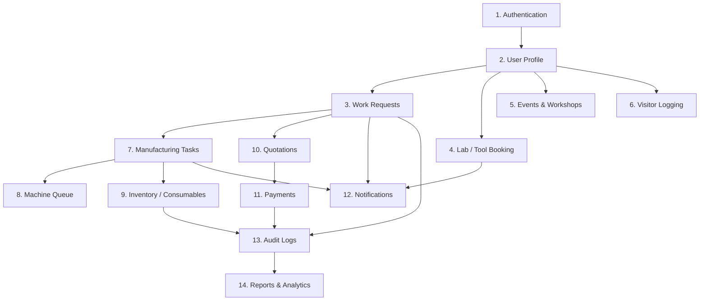

# Grow Platform Module Dependency Graph

Status: Approved  
Owner: Lead Architect  
Version: 1.0  
Last updated: 2026-08-04  
Depends on: `docs/01_Product/00_PRODUCT_CHARTER.md`, `docs/02_Architecture/REPOSITORY_ARCHITECTURE.md`  

---

## 1. High-Level Dependency Graph

---

## 2. Detailed Module Matrix

| Module | Depends On | Required Before | Blocks | Blocked By |
| --- | --- | --- | --- | --- |
| **1. Authentication** | Supabase Auth, Firebase Auth | User Profile | All operational modules | Domain configuration |
| **2. User Profile** | Authentication | Work Requests, Booking, Events, Visitors | Work Requests | Profile onboarding schema |
| **3. Work Requests** | User Profile | Manufacturing Tasks, Quotations | Manufacturing Tasks, Payment | SRS approval (Done for V1 scope) |
| **4. Lab / Tool Booking** | User Profile, Lab Master Data | Consumables, Machine Maintenance | Machine Runtime | Overlap constraint DB rules |
| **5. Events & Workshops** | User Profile | Attendance, Certificates | Certificate Generation | Events Head dashboard |
| **6. Visitor Logging** | User Profile, Master Data | Daily/Weekly Operational Reports | Visitor Reports | QR badge policy |
| **7. Manufacturing Tasks** | Work Requests | Machine Queue, Consumables | Machine Queue | Phase 2 ERD |
| **8. Machine Queue** | Manufacturing Tasks, Machine Master Data | Machine Runtime Records | Machine Assignment | Machine Head queue view |
| **9. Inventory** | Master Data | Consumable Deduction, Borrowing | Borrowing, Procurement | Operation Head CSV import spec |
| **10. Quotations** | Work Requests | Payment Workflow | Payment Collection | Cost calculation template |
| **11. Payments** | Quotations | Work Request Completion | Work Execution Gate | Manual UPI verification rule |
| **12. Notifications** | Work Requests, Tasks, Booking | In-App Inbox | Push Notifications (V2) | Notification RLS trigger |
| **13. Audit Logs** | All Operational Modules | Reporting, Compliance | Security Audits | Audit schema trigger |
| **14. Reports & Analytics** | Audit Logs, Inventory, Visitors | Management Dashboard | Operation Head Export | Audit log baseline |
