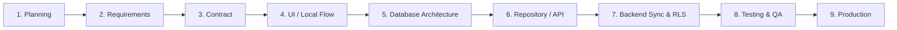

# Grow Platform Module Lifecycle Standard

Status: Approved  
Owner: Lead Architect  
Version: 1.0  
Last updated: 2026-08-04  
Depends on: `docs/01_Product/00_PRODUCT_CHARTER.md`, `docs/02_Architecture/REPOSITORY_ARCHITECTURE.md`  

---

## 1. Lifecycle Phases

Every operational feature module (Work Requests, Manufacturing Tasks, Machine Queue, Inventory, Payments, Borrowing, Visitors, Events) MUST pass through 9 phase gates sequentially.

---

## 2. Gate Criteria & Deliverables

| Phase Gate | Required Deliverables | Mandatory Approver | Phase Guard Rule |
| --- | --- | --- | --- |
| **1. Planning** | Feature entry in `PRODUCT_BACKLOG.md` & `FEATURE_INVENTORY.md` | Product Owner | Phase 1 active |
| **2. Requirements** | SRS document in `docs/01_Product/` with validator rules & field table | Product Owner | Phase 1 active |
| **3. Contract** | Implementation Contract in `docs/01_Product/` freezing V1 boundaries | Lead Architect | Phase 1 active |
| **4. UI / Local Flow** | Screen, Riverpod controller, local persistence (`SharedPreferences`), widget tests | Lead Architect | CI Architecture Guard blocks `data/` & `domain/` |
| **5. DB Architecture** | ERD diagram, SQL migration script in `supabase/migrations/`, RLS matrix | Lead Architect & Security Owner | Architecture Guard path unlocked by PR |
| **6. Repository / API** | Repositories in `lib/features/<module>/data/repositories/`, DTO mappers | Lead Architect | Code audit passes |
| **7. Backend Sync & RLS** | Realtime subscriptions, offline queue handlers, RLS policy tests | Lead Security Auditor | No RLS bypass |
| **8. Testing & QA** | Unit, widget, chaos/network failure, and device QA reports | Lead QA / Core Team | 100% green CI |
| **9. Production** | Release Candidate tag merge, feature flag default `true` | Product Owner & Lead Architect | Tagged build green |

---

## 3. Strict Rules

1. **No skipping gates**: A module MUST NOT write SQL migrations (Phase 5) before UI Contract approval (Phase 3).
2. **Phase 1 Boundary**: In Phase 1, modules stop at **Gate 4 (UI / Local Flow)**. Zero Supabase tables, zero cloud repositories, zero API clients.
3. **Rollback**: If business rules change during Gate 4, the module drops back to Gate 2 (Requirements) for review.
