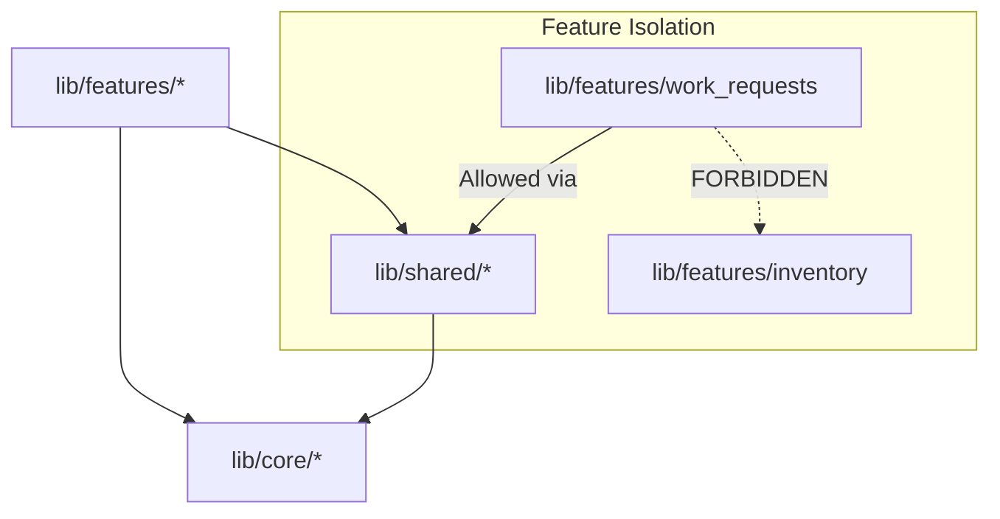

# Grow Platform Repository Architecture Guide

Status: Approved  
Owner: Lead Architect  
Version: 1.0  
Last updated: 2026-08-04  
Depends on: `docs/01_Product/00_PRODUCT_CHARTER.md`, `docs/DOCUMENTATION_GOVERNANCE.md`  

---

## 1. Executive Summary

This guide serves as the authoritative blueprint for the physical, architectural, and operational layout of the Grow platform repository. It governs folder structure, feature modularity, dependency boundaries, coding conventions, testing strategies, and branch workflows.

---

## 2. Directory Layout & Purpose

```text
grow/
├── .github/                   # CI/CD workflows, PR templates, issue forms, architecture guard
├── android/                   # Native Android application configuration & runner
├── assets/                    # Static assets (fonts, design tokens)
├── docs/                      # Local-only planning, architecture, product & governance docs
├── integration_test/          # Flutter integration & device E2E tests
├── lib/                       # Application Dart source code
│   ├── main.dart              # App bootstrap, Firebase/Supabase initialization, ProviderScope
│   ├── firebase_options.dart  # Firebase dart-define configuration
│   ├── core/                  # Cross-cutting constants, theme tokens, router, services
│   ├── shared/                # Feature-agnostic DTOs, repositories, widgets, utilities
│   └── features/              # Feature modules (feature-first architecture)
├── supabase/                  # Database schema definitions & SQL migrations
├── test/                      # Unit & widget test suite
├── .env.example               # Template for local secret environment variables
├── pubspec.yaml               # Flutter package manifest & dependency declarations
└── [ROOT_GOVERNANCE_DOCS]     # README.md, DEV_WORKFLOW.md, CODING_STANDARD.md, etc.
```

---

## 3. Feature-First Module Structure

Every feature lives under `lib/features/<feature_name>/` and follows this standard sub-directory layout:

```text
lib/features/<feature_name>/
├── application/
│   └── providers/             # Riverpod StateNotifiers, Notifiers, and state classes
├── constants/                 # Option definitions, master data lists, UI constants
├── models/                    # DTOs, pure state objects, draft data structures
├── presentation/
│   ├── screens/               # Complete screen widgets
│   └── widgets/               # Section-level & reusable sub-widgets
├── services/                  # Local storage, device APIs, helper services
└── utils/                     # Pure validation & format functions
```

### Data & Domain Layer Boundary Rule
- `lib/features/<feature_name>/data/` and `lib/features/<feature_name>/domain/` are **strictly prohibited** in Phase 1.
- The CI **Architecture Phase Guard** (`.github/ci/architecture_guard_paths.txt`) automatically blocks any commits touching `data/` or `domain/` for gated modules until Phase 2 ERD/RLS approval is granted.

---

## 4. Dependency Rules (Layer Coupling Controls)



1. **Features MUST NOT directly import other features.** Cross-feature communication must go through `lib/shared/` or global Riverpod providers.
2. **Core MUST NOT import Features or Shared.** `lib/core/` is the base layer (theme, router, constants, low-level loggers).
3. **Shared MAY import Core, but MUST NOT import Features.**

---

## 5. Naming Conventions

| Entity | Case / Pattern | Example |
| --- | --- | --- |
| File names | `snake_case.dart` | `work_request_draft.dart` |
| Class names | `PascalCase` | `WorkRequestCreateController` |
| Variable / Function | `camelCase` | `validateTitle()` |
| Enum names | `PascalCase` | `WorkRequestPriority` |
| Provider instances | `camelCaseProvider` | `workRequestCreateControllerProvider` |
| Route paths | `/kebab-case` | `/work-requests/create` |
| Validator methods | `validate<Field>()` | `validateDescription()` |

---

## 6. Testing Strategy

- **Location**: All unit & widget tests live under `test/` mirroring `lib/` paths.
- **Naming**: `test/<feature_name>_<context>_test.dart`.
- **Framework**: `flutter_test`, `flutter_riverpod`.
- **Mocks**: `SharedPreferences.setMockInitialValues({})` for local storage; no live network calls in tests.
- **Coverage**: Minimum 80% coverage for validators, controllers, and state storage classes.

---

## 7. Authoritative Governance Pointers

For full workflow rules, consult the root governance files:
- **PR & Merge Workflow**: [`/DEV_WORKFLOW.md`](file:///f:/kannan/projects/Grow/grow/DEV_WORKFLOW.md)
- **Coding Standards**: [`/CODING_STANDARD.md`](file:///f:/kannan/projects/Grow/grow/CODING_STANDARD.md)
- **System Boundaries**: [`/SYSTEM_BOUNDARIES.md`](file:///f:/kannan/projects/Grow/grow/SYSTEM_BOUNDARIES.md)
- **Definition of Done**: [`/DEFINITION_OF_DONE.md`](file:///f:/kannan/projects/Grow/grow/DEFINITION_OF_DONE.md)
- **Branch Protection Policy**: [`/BRANCH_PROTECTION.md`](file:///f:/kannan/projects/Grow/grow/BRANCH_PROTECTION.md)
