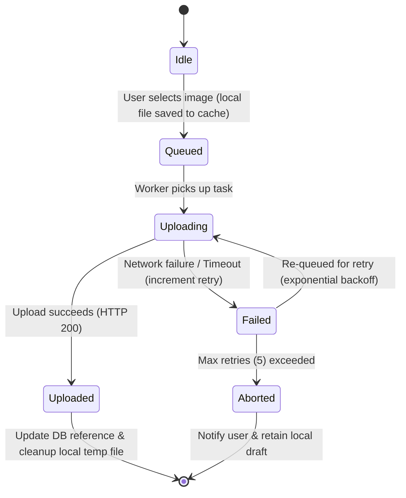

# Media Upload Sync State Machine

This document outlines the state machine design for handling offline media uploads, image resizing, retries, and storage reconciliation.

## CURRENT IMPLEMENTATION STATUS
* **Media Upload Sync**: `Status: planned for Phase B` - This state machine draft guides the future implementation.

---

## 1. Lifecycle State Machine Diagram

---

## 2. States and Transitions

### 2.1 State: `Idle`
- The system is waiting for media selection.

### 2.2 State: `Queued`
- The image has been compressed and stored in the local cache directory (`/data/user/0/com.grow.app/cache/`).
- An upload record is added to the `media_uploads` database table.

### 2.3 State: `Uploading`
- The background task calls `supabase.storage.from(bucket).upload()`.
- Progress callbacks are emitted to update the sync visualization screen.

### 2.4 State: `Uploaded`
- The remote URL is successfully obtained.
- The parent metadata record (e.g. `avatar_url` in `user_profiles`) is updated.
- The local cache file is deleted.

### 2.5 State: `Failed`
- Triggered by socket timeouts or network flapping.
- Retries scale using exponential backoff.

### 2.6 State: `Aborted`
- Marked when retries hit the max limit. The upload queue remains suspended until manual retry is requested by the user.

---

## 3. Orphan File Reconciliation

To prevent storage bucket bloat:
- When a user changes their avatar, the old remote file is not deleted immediately from the bucket (since the delete could fail if offline).
- Instead, a background sweep operation runs periodically when online, comparing database `avatar_url` paths against objects in the `avatars` bucket and purging unreferenced media.
