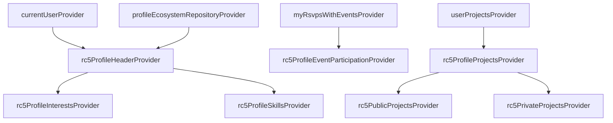

# Riverpod Provider Graphs

This document details the Riverpod provider structure and dependency mappings for the profile ecosystem.

## CURRENT IMPLEMENTATION STATUS
* **Provider Mappings**: `Status: fully implemented` - Defined in `rc5_profile_providers.dart` and integrated into UI screen listeners.

---

## 1. Provider Dependency Graph



### 1.1 `rc5ProfileHeaderProvider`
- Watches `currentUserProvider`.
- Invokes `ProfileMigrationService` inside `ProfileMigrationCoordinator` if the user is not migrated.
- Exposes combined user profile data (username, bio, interests, skills).
- Implements offline fallback to the local SharedPreferences cache.

### 1.2 Derived Providers
- `rc5ProfileInterestsProvider`: Maps interests from the header.
- `rc5ProfileSkillsProvider`: Maps skills from the header.
- `rc5ProfileProjectsProvider`: Maps user projects (collaboration/showcase).

---

## 2. Invalidation and Cache Rebuild Loops

To avoid rebuilding loops:
- UI screens invalidate `rc5ProfileHeaderProvider` on save.
- **Rules**: Never invalidate `rc5ProfileHeaderProvider` directly inside a builder, constructor, or repository callback. Only invoke `ref.invalidate(...)` inside UI event handlers (e.g. `onPressed` save buttons).
- This prevents rebuild loops during offline-replay drains.
```
