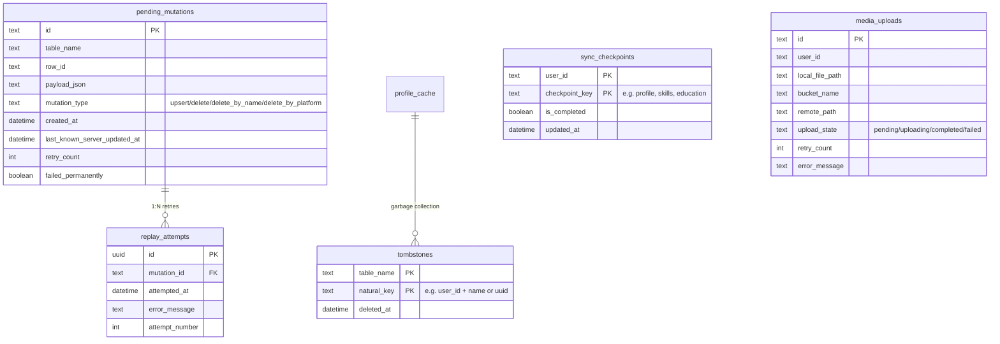

# Phase B RFC: Local SQLite (Drift) Storage Schema

This RFC proposes the table structures and constraints for migrating the local cache, offline mutation queue, and tombstone deletions from SharedPreferences to SQLite/Drift.

## CURRENT IMPLEMENTATION STATUS
* **SQLite Migration Status**: `Status: planned for Phase B` - This RFC defines the baseline relational architecture to be implemented.

---

## 1. Schema Definition



---

## 2. Table Schemas & Drift Mappings

### 2.1 Table: `pending_mutations`
Tracks offline mutations sequentially.
```dart
class PendingMutations extends Table {
  TextColumn get id => text()();
  TextColumn get tableName => text()();
  TextColumn get rowId => text()();
  TextColumn get payloadJson => text()();
  TextColumn get mutationType => text()(); // upsert, delete, delete_by_name, delete_by_platform
  DateTimeColumn get createdAt => dateTime()();
  DateTimeColumn get lastKnownServerUpdatedAt => dateTime().nullable()();
  IntColumn get retryCount => integer().withDefault(const Constant(0))();
  BoolColumn get failedPermanently => boolean().withDefault(const Constant(false))();

  @override
  Set<Column> get primaryKey => {id};
}
```

### 2.2 Table: `replay_attempts`
Maintains execution history for telemetry and observability diagnostics.
```dart
class ReplayAttempts extends Table {
  TextColumn get id => text()();
  TextColumn get mutationId => text().references(PendingMutations, #id)();
  DateTimeColumn get attemptedAt => dateTime()();
  TextColumn get errorMessage => text().nullable()();
  IntColumn get attemptNumber => integer()();

  @override
  Set<Column> get primaryKey => {id};
}
```

### 2.3 Table: `tombstones`
Tracks local deletions to ensure that offline deleted rows are not re-inserted by incoming remote server updates before sync completion.
```dart
class Tombstones extends Table {
  TextColumn get tableName => text()();
  TextColumn get naturalKey => text()(); // e.g. "user_123:skill:Python" or "user_123:social:github"
  DateTimeColumn get deletedAt => dateTime()();

  @override
  Set<Column> get primaryKey => {tableName, naturalKey};
}
```

### 2.4 Table: `media_uploads`
Manages file uploads to Supabase storage buckets with resume/retry state mappings.
```dart
class MediaUploads extends Table {
  TextColumn get id => text()();
  TextColumn get userId => text()();
  TextColumn get localFilePath => text()();
  TextColumn get bucketName => text()();
  TextColumn get remotePath => text()();
  TextColumn get uploadState => text()(); // pending, uploading, completed, failed
  IntColumn get retryCount => integer().withDefault(const Constant(0))();
  TextColumn get errorMessage => text().nullable()();

  @override
  Set<Column> get primaryKey => {id};
}
```
