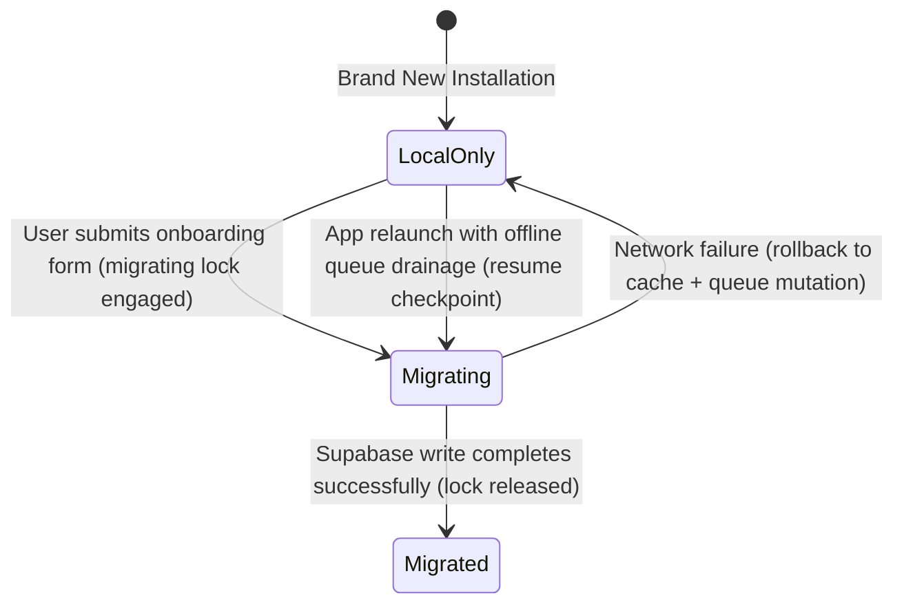

# Profile State Machine & System Architecture

This document explains the onboarding state machine, client-side profile transitions, and systemic constraints governing Riverpod and realtime budgets.

## CURRENT IMPLEMENTATION STATUS
* **State Machine Enum**: `Status: fully implemented` - Defined by `ProfileMigrationState` (`localOnly`, `migrating`, `migrated`).
* **State Coordinator**: `Status: fully implemented` - Mutex coordinator ensuring serialized migration execution.
* **Onboarding Navigation Flow**: `Status: fully implemented` - Tab-navigation integration and redirect rules.
* **Realtime Budget Boundaries**: `Status: fully implemented` - Verified across the event, lab, and notification providers.

---

## 1. Onboarding State Transitions

### 1.1 State: `localOnly`
- Read/write paths resolve to SharedPreferences onboarding cache.
- The user is displayed as "incomplete onboarding" or in draft state if profile doesn't exist on server.

### 1.2 State: `migrating`
- Mutex coordinator block is active.
- App initializes server writes. If a crash or interruption happens, next launch checks state and resumes.

### 1.3 State: `migrated`
- Onboarding is completed on server.
- The draft cache is marked as migrated, and future reads/writes bypass onboarding checks and direct to Supabase tables.

---

## 2. Navigation Flow & Feature Flags

Navigation redirects are governed by the Riverpod provider graphs:
- If a user session is active but `ProfileMigrationState` is NOT `migrated`, the router gates entry to core tabs and displays the onboarding questionnaire.
- If `FeatureFlags.kEnableProfileMigration` is disabled, the router falls back to local onboarding mode.

---

## 3. Realtime Stream Budget Constraints

To prevent performance degradation and CPU jank, Grow~ limits long-lived realtime subscriptions.

### 3.1 Allowed Long-Lived Streams
- Notification count (badge number)
- Lab status (active/closed)
- Active session/booking info

### 3.2 Prohibited Long-Lived Streams
- Full notification lists
- Full events lists
- Full project lists
- Profile-wide database subscriptions
- Unbounded admin dashboards

Instead, paginated fetch queries combined with manual or targeted local invalidation are used.

---

## 4. Offline Actions Policy

### 4.1 Allowed Offline Reads
- Cached user profile display
- Cached Home feed panels
- Events, notifications, and opportunities from the last successful online sync

### 4.2 Blocked Offline Operations (Immediate Network Required)
- Tool booking submissions
- RSVP/Event registration
- Vouch actions
- Admin moderation controls

These blocked operations must display clear user-facing error indicators or SnackBar warnings rather than failing silently.
