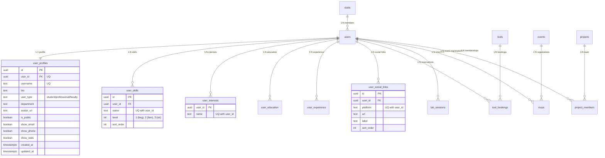

# Database Relational Schema & Fields

> **Verification notice (2026-09-17):** The "production validated" statements
> below are historical claims, not a fresh live-schema comparison. The
> repository contains conflicting schema sources and migration generations.
> See `SCHEMA_AUTH_AUDIT_2026-09-17.md` before using this as an implementation
> contract or applying SQL.

This document defines the relational database model for user profiles, onboarding, lab status, events, opportunities, tools, bookings, lab sessions, and notification tables in Grow~.

## CURRENT IMPLEMENTATION STATUS
* **Profile Ecosystem Schema**: `Status: production validated` - Profile tables defined in migration script `003_profile_ecosystem.sql`.
* **Core Base Tables Schema**: `Status: fully implemented` - Verified in Supabase production and used across app services.

---

## 1. Schema Diagram

---

## 2. Table Mappings & Column References

### 2.1 Table: `users`
Extends the core `auth.users` authentication table.
- `id` (uuid, PK, FK to `auth.users.id`)
- `name` (text, NOT NULL)
- `email` (text, unique, NOT NULL)
- `phone` (text, nullable)
- `college_roll` (text, unique, nullable) - KTU ID identity field.
- `role` (text, NOT NULL, default `'student'`) - **CONSTRAINT:** `IN ('student', 'lab_admin', 'super_admin')`
- `club_id` (uuid, FK to `clubs.id`, nullable)
- `xp` (integer, default `0`)
- `level` (integer, default `1`)
- `qr_code_data` (text, unique, nullable)

### 2.2 Table: `user_profiles`
- `id` (UUID): Primary key.
- `user_id` (UUID): References `auth.users(id)` (unique).
- `username` (text): Unique nickname used for profile routes.
- `bio` (text): Bio string, default empty.
- `user_type` (text): Role constraint (`student`, `professional`, `faculty`).
- `department` (text): Department name or profession.
- `is_public` (boolean): Privacy toggle allowing community lookup.
- `show_stats` (boolean): Privacy toggle showing event / lab visits.

### 2.3 Table: `user_skills`
- `user_id` (UUID): Owner key.
- `name` (text): Name of language/tool (e.g., Python, Flutter).
- `level` (int): Skill depth indicator (1 to 3).
- *Constraint*: `unique_user_skill (user_id, name)`.

### 2.4 Table: `user_interests`
- `user_id` (UUID): Owner key.
- `name` (text): Area of interest (e.g. AI/ML, Programming).
- *Constraint*: `unique_user_interest (user_id, name)`.

### 2.5 Table: `user_social_links`
- `user_id` (UUID): Owner key.
- `platform` (text): Platform name (`github`, `linkedin`, `website`).
- `url` (text): Link address.
- *Constraint*: `unique_user_social_link (user_id, platform)`.

### 2.6 Table: `user_education`
- `id` (UUID): Primary key.
- `user_id` (UUID): References `auth.users(id)`.
- `institution` (text): University / College name.
- `degree` (text): Degree title.
- `field_of_study` (text)
- `end_year` (int)

### 2.7 Table: `user_experience`
- `id` (UUID): Primary key.
- `user_id` (UUID): References `auth.users(id)`.
- `title` (text): Title of role.
- `organization` (text): Employer or project team name.

---

## 3. Inventory & Operations Tables

### 3.1 Table: `tools`
Physical inventory of machines, tools, and developer assets.
- `id` (uuid, PK)
- `name` (text, NOT NULL)
- `category` (text, NOT NULL) - **CONSTRAINT:** `IN ('3d_printer', 'laser', 'electronics', 'woodwork', 'fabrication', 'other')`
- `available_qty` (integer, default `1`)
- `health_status` (text, default `'available'`) - **CONSTRAINT:** `IN ('available', 'in_use', 'maintenance', 'retired')`
- `qr_code_data` (text, unique, nullable)

### 3.2 Table: `tool_bookings`
Reservations and checkouts for physical tools.
- `id` (uuid, PK)
- `tool_id` (uuid, FK to `tools.id`)
- `user_id` (uuid, FK to `users.id`)
- `slot_start` / `slot_end` (timestamptz, NOT NULL)
- `status` (text, default `'pending'`) - **CONSTRAINT:** `IN ('pending', 'approved', 'active', 'returned', 'cancelled', 'rejected')`

### 3.3 Table: `lab_sessions`
Digital gatekeeper ledger for active physical lab entry.
- `id` (uuid, PK)
- `user_id` (uuid, FK to `users.id`)
- `checkin_time` (timestamptz, default `now()`)
- `checkout_time` (timestamptz, nullable)

---

## 4. Community & Content Tables

### 4.1 Table: `opportunities`
- Tracks job, internship, or project call-outs:
  - `posted_by` (UUID): References the creator user.
  - `status` (text): Active state constraint (`draft`, `published`, `expired`, `archived`, `removed`).
  - `grace_period_ends_at` (timestamptz): Visibility buffer after expiration.

### 4.2 Table: `events`
Workshops, hackathons, and activities scheduled inside the physical space.
- `id` (uuid, PK)
- `title` (text, NOT NULL)
- `event_type` (text, default `'workshop'`) - **CONSTRAINT:** `IN ('workshop', 'hackathon', 'talk', 'competition', 'open_lab', 'other')`
- `capacity` (integer)
- `status` (text, default `'upcoming'`) - **CONSTRAINT:** `IN ('upcoming', 'ongoing', 'completed', 'cancelled')`

### 4.3 Table: `rsvps`
Sign-ups and check-ins for events.
- `id` (uuid, PK)
- `event_id` (uuid, FK to `events.id`)
- `user_id` (uuid, FK to `users.id`)
- `checked_in_at` (timestamptz, nullable)

### 4.4 Table: `knowledge_articles`
Peer-reviewed documentation, wiki articles, and technical SOP guides.
- `id` (uuid, PK)
- `title` (text, NOT NULL)
- `author_id` (uuid, FK to `users.id`)
- `is_approved` (boolean, default `false`)

---

## 5. Soft Delete Constraints

To preserve audit trails and prevent broken links:
- Tables for `projects`, `opportunities`, `events`, `vouches`, and `knowledge_articles` implement soft-deletion.
- **Columns**: `deleted_at` (timestamptz) and `deleted_by` (UUID) are set to trace deleted records.
- Queries default to filtering out rows where `deleted_at IS NOT NULL`.
