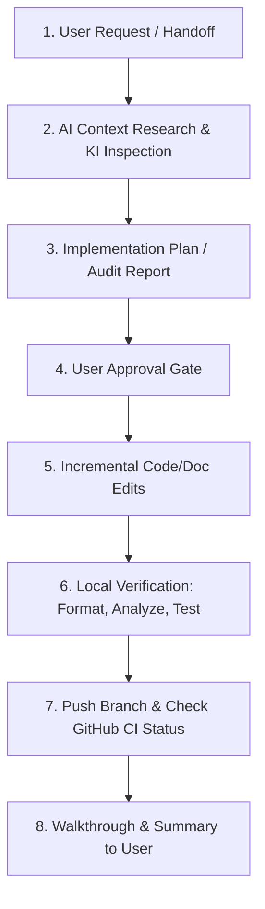

# Grow Platform AI-Assisted Development Guide

Status: Approved  
Owner: Lead Architect  
Version: 1.0  
Last updated: 2026-08-04  
Depends on: `/DEV_WORKFLOW.md`, `/CODING_STANDARD.md`, `docs/DOCUMENTATION_GOVERNANCE.md`  

---

## 1. Overview & Purpose

This guide formalizes the AI-assisted pair programming and agentic coding workflow for the Grow platform repository. It establishes model roles, verification boundaries, prompt patterns, handoff structures, and governance rules when collaborating with AI assistants (Antigravity, Codex, ChatGPT, Claude).

---

## 2. AI Tooling Roles & Capabilities

| Tool / Assistant | Primary Role | Operational Boundary |
| --- | --- | --- |
| **Antigravity (Google DeepMind)** | Lead Agentic Pair Programmer & Architectural Auditor | Executing complex codebase audits, multi-file refactoring, test execution, document generation, interactive user clarification, terminal commands. |
| **Codex / GitHub Copilot** | Inline Code Completion & Local Generation | Real-time code completions, single-function generation, boilerplates within open files. |
| **ChatGPT / Claude (External)** | High-Level Design & Strategic Consultation | Reviewing architectural concepts, writing raw product specifications, strategic brainstorming before repository execution. |

---

## 3. Core Operating Rules for AI Agents

1. **Verify Before Declaring Green**: Never claim a test passed or a feature works without executing `dart format`, `flutter analyze`, and `flutter test` directly in the shell and parsing the output.
2. **Never Trust Unverified CI Claims**: Treat GitHub status checks as `pending` until verified via MCP or gh CLI queries.
3. **Respect Governance Gates**: Never commit directly to protected branches (`main`, `rc5-release-candidate`). All code changes go through feature branches → PR → green CI.
4. **Respect Architecture Guards**: Do not touch `lib/features/*/data/` or `lib/features/*/domain/` until Phase 2 approval is explicitly logged.
5. **Archive, Never Delete Ignored Docs**: Since `docs/` is git-ignored, hard-deleting documentation files is forbidden unless byte-for-byte identity (`Get-FileHash`) is verified.
6. **No Snippet Tunnel Vision**: Inspect full file context using `view_file` before making structural edits.

---

## 4. Session Handoff Prompt Template

When ending a session or passing context to a new AI session, format the handoff prompt as follows:

```markdown
Context: [Summary of completed PR or task]

Completed in this session:
- [Item 1]
- [Item 2]

Not yet done / Next steps:
- [Item 1]
- [Item 2]

Branch: [Active feature branch name]
Governance: phase-gated, PR-first, no direct commits to rc5-release-candidate
Architecture guard: [State of gated paths]
Verification state: [Output of analyze/test/format]
```

---

## 5. Standard AI Workflow Sequence


