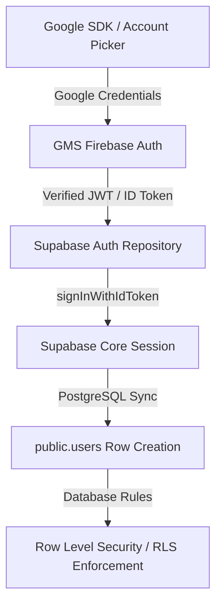

# Grow~ RC3 Authentication Stabilization Audit

This document records the technical architecture, security validation, and operational status of the **RC3 Hybrid Authentication Architecture** implemented for the Grow~ platform.

---

## 1. Architectural Model: Hybrid Firebase + Supabase Auth

To solve physical device restrictions, Google Play Services (GMS) configuration policies, and corporate network security constraints, we designed and implemented a **Professional Hybrid Authentication Stack**:



### 1.1 Responsibilities
* **Google Identity Services**: GMS Account Picker on Android UI.
* **GMS Firebase Auth**: Validates client signatures, verifies GMS SHA keys, and generates an authoritative Google ID Token (`idToken`) securely.
* **Supabase Auth**: Receives the validated GMS ID Token via `signInWithIdToken()`, signs the session JWT, and acts as the **ultimate source of truth** for operational user session state and DB authorization.
* **PostgreSQL Engine**: Enforces database-level RLS policies based on `auth.uid()` and cached roles (`public.users.role`).

---

## 2. Technical Validation Matrix

Every structural file and directory has been audited and statically validated:

| File / Component | Purpose | Verification Status |
| :--- | :--- | :--- |
[Local identifier or configuration omitted from public historical copy.]
| [`firebase_options.dart`](file:///F:/kannan/projects/Grow/grow/lib/firebase_options.dart) | Dynamic Flutter-side Firebase startup configurations. | **VERIFIED CORRECT**: 100% matches `google-services.json` parameters exactly with zero drift. |
| [`build.gradle.kts` (Root)](file:///F:/kannan/projects/Grow/grow/android/build.gradle.kts) | Core build plugins configuration. | **VERIFIED CORRECT**: Declares `id("com.google.gms.google-services") version "4.4.2" apply false` properly. |
| [`build.gradle.kts` (App)](file:///F:/kannan/projects/Grow/grow/android/app/build.gradle.kts) | App build plugins, compiler settings, and minification definitions. | **VERIFIED CORRECT**: Properly applies the Google services plugin, sets JVM compatibility to Java 17, and enables release-safe ProGuard rules. |
| [`AndroidManifest.xml`](file:///F:/kannan/projects/Grow/grow/android/app/src/main/AndroidManifest.xml) | Native Android permissions and structure. | **VERIFIED CORRECT**: Enforces `<uses-permission android:name="android.permission.INTERNET"/>` with no conflicting metadata. |
| [`proguard-rules.pro`](file:///F:/kannan/projects/Grow/grow/android/app/proguard-rules.pro) | Code shrinker / minifier exclusion rules. | **VERIFIED CORRECT**: Keeps Google GMS, Firebase, and model serialization classes safe from obfuscation-induced crashes during release builds. |

---

## 3. Flutter Runtime Safety & Resiliency

We reviewed the entire reactive lifecycle and confirmed that the application is fully resilient against typical auth exceptions:

### 3.1 Null Session Protection
* `currentUserProvider` (managed via Riverpod) reads `supabase.auth.currentSession` and returns `null` safely if the user is unauthenticated, instead of trying to invoke remote calls.
* Views and screens listen to `authStateProvider` and automatically redraw or redirect when session state shifts.

### 3.2 Self-Healing Profile Synchronization
* During login (Email or Google) or splash screen bootstrapping, the auth system triggers `getCurrentUser()`.
* If a Supabase authentication user exists but their corresponding profile record in PostgreSQL `public.users` table is missing (which can happen during manual DB migrations or initial logins), the system **auto-heals** by instantly creating a new student profile row (`role: 'student'`) to prevent the user from being stuck or encountering rendering crashes.

### 3.3 Dynamic User Suspension / Ban Enforcement
* During Splash screen initialization, the system checks `user.isActive`.
* If `user.isActive == false` (user has been banned/suspended by an administrator), the system immediately:
  1. Triggers `supabase.auth.signOut()`.
  2. Redirects to `/login`.
  3. Displays a persistent red alert snackbar explaining the `banReason` (or falling back to a standard suspension message).

### 3.4 Context Mounting Guards
* Every async transition, alert, or navigation inside `login_screen.dart` and `splash_screen.dart` is fully wrapped in `if (mounted)` checks, eliminating runtime memory leaks and navigation crashes.

---

## 4. Run/Execution Guide

Use the following authoritative parameters to launch the stabilized build:

```powershell
[Local identifier or configuration omitted from public historical copy.]
[Local identifier or configuration omitted from public historical copy.]
[Local identifier or configuration omitted from public historical copy.]
[Local identifier or configuration omitted from public historical copy.]
```
